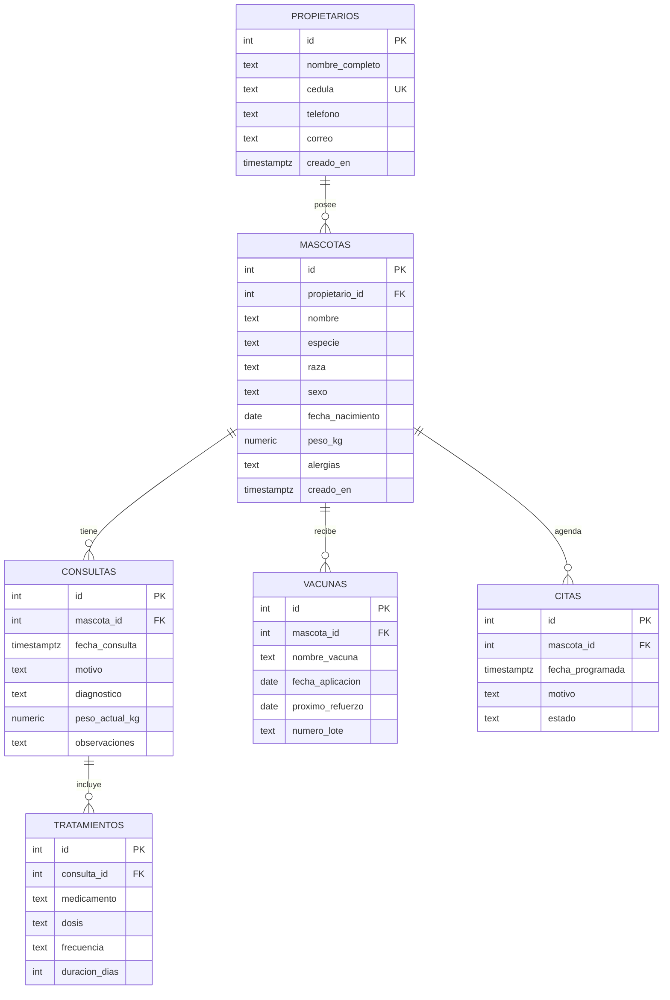

# PRD · Historia clínica veterinaria

> Documento de requisitos del producto (Product Requirements Document).
> Complétalo en el Sprint 0 (historia H0.3) y pide la aprobación del profesor en un Issue.
> Cada requisito funcional (RF) se convierte en un Issue con la plantilla "Historia de usuario".
| Campo | Valor |
| --- | --- |
| Alumno | Joseph Pavón |
| Proyecto n.º | 16 |
| Sitio de referencia | PetDesk |
| Compañero revisor | |
| URL desplegada | (se completa en el Sprint 5) |

## 1. Problema

En clínicas y consultorios veterinarios pequeños o medianos, los expedientes clínicos de las mascotas suelen llevarse en fichas de papel u hojas de cálculo dispersas. Esto provoca pérdida de antecedentes médicos, dificultad para hacer seguimiento a esquemas de vacunación y demoras al atender emergencias. El problema afecta directamente a los médicos veterinarios durante la consulta y a los propietarios de mascotas que necesitan conocer el estado de salud y próximos refuerzos de sus animales.

## 2. Usuarios

- **Usuario principal:** Médico veterinario o asistente clínico. Necesita consultar rápidamente el historial de una mascota, registrar diagnósticos, prescribir tratamientos y actualizar vacunas durante la atención. Entra desde computadora de escritorio (1280 px) en el consultorio o tableta/móvil (375 px) en áreas de revisión.
- **Usuario secundario:** Propietario de la mascota (tutor). Necesita consultar el resumen clínico de sus animales registrados, revisar vacunas aplicadas y verificar las próximas fechas de refuerzo o control desde su teléfono móvil (375 px).

## 3. Objetivo y métrica de éxito

Un médico veterinario localiza el expediente de una mascota y registra una nueva consulta clínica con su diagnóstico y tratamiento en menos de 45 segundos, sin errores de validación ni pérdida de historial previo.

## 4. Alcance del MVP

1. Gestión de propietarios (registro, búsqueda y actualización de datos de contacto).
2. Gestión de mascotas/pacientes vinculadas a su propietario (especie, raza, sexo, fecha de nacimiento, peso y alergias).
3. Registro y línea de tiempo cronológica de consultas clínicas (motivo, anamnesis, signos vitales, diagnóstico y observaciones).
4. Gestión de tratamientos y prescripciones médicas asociadas a cada consulta.
5. Control de esquema de vacunación (vacunas aplicadas, lote, fecha de aplicación y fecha de próximo refuerzo).
6. Agenda básica de próximas citas y controles preventivos.

### Funcionalidades → carpetas de `src/` (screaming architecture)

| Funcionalidad | Carpeta |
| --- | --- |
| Propietarios | `src/owners` |
| Mascotas / Pacientes | `src/pets` |
| Consultas clínicas | `src/consultations` |
| Tratamientos y recetas | `src/treatments` |
| Vacunación | `src/vaccinations` |
| Citas y controles | `src/appointments` |

## 5. Fuera de alcance

- Facturación electrónica, punto de venta e inventario de farmacia/tienda.
- Portal de pagos en línea o pasarelas bancarias.
- Telemedicina por videollamada en tiempo real o chat integrado.
- Envío automático de notificaciones por WhatsApp o SMS externo.
- Gestión multi-sucursal con inventario compartido entre clínicas.

## 6. Requisitos funcionales

| ID | Requisito | Prioridad (alta, media, baja) |
| --- | --- | --- |
| RF-01 | Registrar, listar, editar y buscar propietarios por nombre, cédula o teléfono. | alta |
| RF-02 | Registrar y actualizar mascotas asociadas a un propietario (especie, raza, sexo, peso, fecha de nacimiento). | alta |
| RF-03 | Visualizar el expediente clínico unificado de una mascota con su historial cronológico ordenado del más reciente al más antiguo. | alta |
| RF-04 | Registrar una consulta médica vinculada a una mascota con motivo, diagnóstico, peso actual y notas clínicas. | alta |
| RF-05 | Asociar uno o varios medicamentos/tratamientos (dosis, frecuencia, duración) a una consulta clínica. | media |
| RF-06 | Registrar vacunas aplicadas a una mascota indicando nombre del biológico, fecha de aplicación y fecha sugerida de próximo refuerzo. | alta |
| RF-07 | Agendar y filtrar citas de control veterinario por fecha y estado (pendiente, completada, cancelada). | media |
| RF-08 | Filtrar mascotas con vacunas próximas a vencer en los siguientes 15 días. | baja |

## 7. Requisitos no funcionales

- Diseño adaptable (móvil primero: 375 px y 1280 px).
- Puntuación ≥ 90 en Accesibilidad y Buenas prácticas en auditoría de rendimiento web.
- 0 errores en la consola del navegador.
- Funciona con 10.000 registros sin congelarse.
- Todas las consultas a PostgreSQL deben estar parametrizadas (`$1`, `$2`) y validadas con Zod antes de ejecutarse.
- Tiempo de respuesta de las rutas de consulta del historial clínico menor a 300 ms en entorno local.

## 8. Modelo de datos

Diagrama entidad-relación y tablas PostgreSQL con tipos, claves y restricciones.
GitHub dibuja diagramas Mermaid; edita este ejemplo:

## 9. Reto técnico distintivo

**Línea de tiempo clínica unificada y alertas de refuerzos preventivos (inspirado en PetDesk) con paginación eficiente sobre más de 10.000 registros:**
Consolidar en una sola vista cronológica eventos heterogéneos de cada mascota (consultas médicas, tratamientos activos, vacunas aplicadas y citas programadas) sin degradar el rendimiento de PostgreSQL ni congelar la interfaz. Se resolverá mediante consultas SQL parametrizadas con índices compuestos en `(mascota_id, fecha_consulta DESC)` y `(mascota_id, proximo_refuerzo)`, paginación por cursor o límite en el servidor y carga bajo demanda en el cliente.

## 10. Riesgos y preguntas abiertas

- **Riesgo de rendimiento en listados masivos:** Al poblar la base de datos con 10.000 registros de prueba, las búsquedas por texto libre en propietarios o mascotas pueden volverse lentas si no se definen índices adecuados o paginación estricta en cada ruta de consulta.
- **Riesgo de integridad histórica:** Evitar el borrado físico (`DELETE`) de consultas o vacunas pasadas para no alterar el historial médico legal; implementar desactivación lógica o restricción de edición tras cerrar la consulta.
- **Pregunta abierta:** ¿El catálogo exige algún reto técnico específico adicional para el proyecto n.º 16 (por ejemplo, exportación de carnet de vacunación o cálculo automático de dosis por peso) que deba priorizarse en los primeros ciclos de desarrollo?
